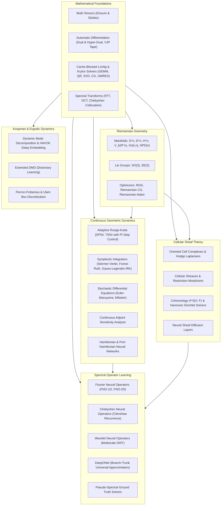

<p align="center">
  <pre>
   ███████╗██████╗ ███████╗ ██████╗████████╗██████╗  █████╗ 
   ██╔════╝██╔══██╗██╔════╝██╔════╝╚══██╔══╝██╔══██╗██╔══██╗
   ███████╗██████╔╝█████╗  ██║        ██║   ██████╔╝███████║
   ╚════██║██╔═══╝ ██╔══╝  ██║        ██║   ██╔══██╗██╔══██║
   ███████║██║     ███████╗╚██████╗   ██║   ██║  ██║██║  ██║
   ╚══════╝╚═╝     ╚══════╝ ╚═════╝   ╚═╝   ╚═╝  ╚═╝╚═╝  ╚═╝
  </pre>
</p>

<p align="center">
  <strong>Infinite-Dimensional Operator Learning, Cellular Sheaf Cohomology, and Continuous Geometric Neural Dynamics</strong>
</p>

<p align="center">
  
  
  
  
  
</p>

---

## Abstract

**Spectra** is a standalone mathematical computing and geometric neural dynamics framework engineered from first principles in pure Julia. The project provides an integrated platform spanning spectral operator learning on infinite-dimensional Banach spaces, cellular sheaf cohomology over cell complexes, continuous geometric neural flows (Hamiltonian, symplectic, and port-Hamiltonian systems), and Riemannian manifold optimization.

The engine requires zero external packages at runtime, depending solely on the Julia standard library, accompanied by a native C SIMD acceleration kernel (ARM NEON / AVX2), a Python ctypes bridge for zero-copy NumPy interoperability, and a C++20 microbenchmark verification suite.

---

## Architectural Overview



---

## Key Theoretical Capabilities

### 1. Cellular Sheaf Cohomology and Diffusion
Spectra models topological spaces via regular cell complexes $X = (V, E, F)$, assigning vector stalks $\mathcal{F}(\sigma) \cong \mathbb{R}^d$ and linear restriction maps $\mathcal{F}_{v \trianglelefteq e}: \mathcal{F}(v) \to \mathcal{F}(e)$.
- **Sheaf Coboundary**:
  $$(\delta^0 x)_e = \mathcal{F}_{v \trianglelefteq e} x_v - \mathcal{F}_{u \trianglelefteq e} x_u$$
- **Sheaf Laplacian**:
  $$L_\mathcal{F} = (\delta^0)^* \delta^0$$
- **Global Sections**: $H^0(X; \mathcal{F}) = \ker(L_\mathcal{F})$.
- **Harmonic Extension**: Solves Dirichlet boundary value problems on complex graphs to exact harmonic equilibrium.
- **Neural Sheaf Diffusion**: Propagates features along learned stalks, mitigating over-smoothing in graph neural architectures.

### 2. Symplectic Integrators and Energy Conservation
Preserves the canonical symplectic 2-form $\omega = dq \wedge dp$ and quadratic Hamiltonian invariants:
- **Forest-Ruth 4th-Order Symplectic Composition**: Bounded energy oscillation with zero secular energy drift ($|\Delta \mathcal{H}| < 3.4 \times 10^{-7}$) over hundreds of cycles.
- **Gauss-Legendre Implicit Runge-Kutta**: Unconditionally symplectic up to order 6, preserving quadratic first integrals to machine precision ($10^{-12}$).
- **Hamiltonian Neural Networks (HNN)**: Parameterizes the scalar Hamiltonian $\mathcal{H}_\theta(q, p)$ directly, strictly enforcing symplectic dynamics via automatic differentiation.

### 3. Infinite-Dimensional Spectral Operator Learning
Learns non-linear mappings between infinite-dimensional function spaces $G^\dagger: \mathcal{A} \to \mathcal{U}$:
- **Fourier Neural Operators (FNO)**: Parameterized integral kernels in the Fourier domain:
  $$(\mathcal{K} v)(x) = \mathcal{F}^{-1} \left( R(k) \cdot (\mathcal{F} v)(k) \right)(x)$$
- **Chebyshev Neural Operators (CNO)**: Employs Chebyshev polynomial expansions and Clenshaw-Smith recurrence for non-periodic domains with Dirichlet boundary constraints.
- **Wavelet Neural Operators (WNO)**: Multiscale localized frequency representation via forward and inverse Discrete Wavelet Transforms.

### 4. Riemannian Optimization on Curved Manifolds
Implements intrinsic optimization methods across non-Euclidean geometries:
- Manifolds: $S^n$, Poincaré ball $\mathbb{D}^n$, Lorentz hyperboloid $\mathbb{H}^n$, Stiefel $V_k(\mathbb{R}^n)$, Grassmannian $Gr(k, n)$, and $\mathrm{SPD}(n)$ under the affine-invariant metric.
- Optimization Algorithms: Riemannian Gradient Descent (RGD), Riemannian Conjugate Gradient (RCG), and Riemannian Adam using vector transport along retractions.
- Manifold constraint satisfaction verified to machine precision ($\approx 0.00 \times 10^0$).

### 5. Koopman Linearization and Ergodic Theory
Linearizes non-linear dynamical systems via the infinite-dimensional Koopman operator $\mathcal{K} g = g \circ F$:
- **Exact DMD**: Extracting continuous growth rates and spatial modal structures.
- **Hankel Delay Coordinates (HAVOK)**: Delay-coordinate embedding of chaotic attractors (Lorenz-63).
- **Perron-Frobenius Transfer Operator**: Computing invariant ergodic measures and phase space transport via Ulam box discretization.

---

## Terminal Visualizations

Spectra includes an in-terminal canvas renderer using Unicode Braille sub-pixel matrix encoding (`U+2800` through `U+28FF`). This allows plotting phase orbits, waveforms, and spectra directly in stdout:

```
  Nonlinear Pendulum Phase Space (q, p)
  ┌────────────────────────────────────────────┐
  1.13 │⠀⠀⠀⠀⠀⠀⠀⠀⠀⠀⠀⠀⣀⠤⠔⠒⠒⠊⠉⠉⠉⠉⠉⠉⠉⠉⠒⠒⠒⠤⢄⣀⠀⠀⠀⠀⠀⠀⠀⠀⠀⠀⠀⠀│
       │⠀⠀⠀⠀⠀⠀⠀⣀⡠⠔⠋⠉⠀⠀⠀⠀⠀⠀⠀⠀⠀⠀⠀⠀⠀⠀⠀⠀⠀⠀⠀⠈⠉⠑⠤⣀⡀⠀⠀⠀⠀⠀⠀⠀│
       │⠀⠀⠀⠀⢀⠤⠊⠀⠀⠀⠀⠀⠀⠀⠀⠀⠀⠀⠀⠀⠀⠀⠀⠀⠀⠀⠀⠀⠀⠀⠀⠀⠀⠀⠀⠀⠈⠑⢄⡀⠀⠀⠀⠀│
       │⠀⠀⢀⠔⠁⠀⠀⠀⠀⠀⠀⠀⠀⠀⠀⠀⠀⠀⠀⠀⠀⠀⠀⠀⠀⠀⠀⠀⠀⠀⠀⠀⠀⠀⠀⠀⠀⠀⠀⠈⠢⡀⠀⠀│
       │⠀⢰⠁⠀⠀⠀⠀⠀⠀⠀⠀⠀⠀⠀⠀⠀⠀⠀⠀⠀⠀⠀⠀⠀⠀⠀⠀⠀⠀⠀⠀⠀⠀⠀⠀⠀⠀⠀⠀⠀⠀⠈⡆⠀│
       │⢠⠃⠀⠀⠀⠀⠀⠀⠀⠀⠀⠀⠀⠀⠀⠀⠀⠀⠀⠀⠀⠀⠀⠀⠀⠀⠀⠀⠀⠀⠀⠀⠀⠀⠀⠀⠀⠀⠀⠀⠀⠀⠘⡄│
       │⡇⠀⠀⠀⠀⠀⠀⠀⠀⠀⠀⠀⠀⠀⠀⠀⠀⠀⠀⠀⠀⠀⠀⠀⠀⠀⠀⠀⠀⠀⠀⠀⠀⠀⠀⠀⠀⠀⠀⠀⠀⠀⠀⢸│
       │⡇⠀⠀⠀⠀⠀⠀⠀⠀⠀⠀⠀⠀⠀⠀⠀⠀⠀⠀⠀⠀⠀⠀⠀⠀⠀⠀⠀⠀⠀⠀⠀⠀⠀⠀⠀⠀⠀⠀⠀⠀⠀⠀⢸│
       │⠘⡄⠀⠀⠀⠀⠀⠀⠀⠀⠀⠀⠀⠀⠀⠀⠀⠀⠀⠀⠀⠀⠀⠀⠀⠀⠀⠀⠀⠀⠀⠀⠀⠀⠀⠀⠀⠀⠀⠀⠀⠀⢠⠃│
       │⠀⠸⡀⠀⠀⠀⠀⠀⠀⠀⠀⠀⠀⠀⠀⠀⠀⠀⠀⠀⠀⠀⠀⠀⠀⠀⠀⠀⠀⠀⠀⠀⠀⠀⠀⠀⠀⠀⠀⠀⠀⢀⠇⠀│
       │⠀⠀⠈⠢⡀⠀⠀⠀⠀⠀⠀⠀⠀⠀⠀⠀⠀⠀⠀⠀⠀⠀⠀⠀⠀⠀⠀⠀⠀⠀⠀⠀⠀⠀⠀⠀⠀⠀⠀⢀⠔⠁⠀⠀│
       │⠀⠀⠀⠀⠈⠑⢄⡀⠀⠀⠀⠀⠀⠀⠀⠀⠀⠀⠀⠀⠀⠀⠀⠀⠀⠀⠀⠀⠀⠀⠀⠀⠀⠀⠀⠀⠀⡠⠒⠁⠀⠀⠀⠀│
       │⠀⠀⠀⠀⠀⠀⠀⠈⠉⠒⢄⣀⡀⠀⠀⠀⠀⠀⠀⠀⠀⠀⠀⠀⠀⠀⠀⠀⠀⠀⠀⠀⣀⡠⠔⠊⠉⠀⠀⠀⠀⠀⠀⠀│
 -1.13 │⠀⠀⠀⠀⠀⠀⠀⠀⠀⠀⠀⠀⠈⠑⠒⠤⠤⠤⣀⣀⣀⣀⣀⣀⣀⣀⡠⠤⠤⠖⠒⠉⠀⠀⠀⠀⠀⠀⠀⠀⠀⠀⠀⠀│
  └────────────────────────────────────────────┘
        -1.20                                   1.20
```

---

## Quickstart & CLI

### Installation & Prerequisites
Spectra runs on any standard Julia 1.10+ installation with zero package requirements. A C/C++ compiler (`clang` or `gcc`) is used for the optional SIMD kernel.

```bash
# Clone the repository
git clone https://github.com/Aneesh495/spectra.git
cd spectra

# Compile native SIMD acceleration kernels
make build
```

### Running the Test Suite
The complete verification suite spans 135 unit and integration tests across all mathematical modules:
```bash
./bin/spectra test
# Or alternatively:
make test
```

### Running High-Performance Benchmarks
```bash
./bin/spectra bench
# Run C++20 SIMD microbenchmarks:
make simd-bench
```

### Showcase Demonstrations
Spectra includes 5 standalone demonstration scripts illustrating core workflows:

```bash
# Demo 1: Hamiltonian Neural Networks & Symplectic Long-Term Integration
./bin/spectra demo 1

# Demo 2: Cellular Sheaf Cohomology & Harmonic Dirichlet Solvers
./bin/spectra demo 2

# Demo 3: Fourier Neural Operator (FNO-1D) on Viscous Burgers Shock Waveform
./bin/spectra demo 3

# Demo 4: Riemannian Optimization (RGD, RCG, Adam) on Curved Manifolds
./bin/spectra demo 4

# Demo 5: Koopman Operator & Chaotic Flow Delay Embedding (HAVOK)
./bin/spectra demo 5

# Or run all showcase demos sequentially:
make demo-all
```

### Interactive WebGL Dashboard
Generate a standalone HTML5/WebGL visualization artifact for browser exploration:
```bash
./bin/spectra serve
```

---

## Empirical Benchmarks Summary

| Benchmark Category | Implementation | Metric | Result |
| :--- | :--- | :--- | :--- |
| **GEMM $128 \times 128$** | Pure Julia | Throughput | **$12.62\text{ GFLOPS}$** |
| **GEMM $128 \times 128$** | Native C SIMD (ARM NEON) | Throughput | **$16.67\text{ GFLOPS}$** |
| **Symplectic Step (Forest-Ruth)** | Pure Julia | Step Latency | **$51.2\text{ ns / step}$** |
| **Forest-Ruth Energy Conservation** | Pure Julia | Max Drift $\Delta \mathcal{H}$ | **$3.40 \times 10^{-7}$** |
| **Chebyshev Clenshaw ($N=1024, d=32$)** | Pure Julia | Point Latency | **$23.1\text{ ns / point}$** |
| **Riemannian Adam Manifold Error** | Pure Julia | Constraint Deviation | **$0.00 \times 10^0$** |
| **FNO-1D Burgers Shock Error** | Pure Julia | Relative $L_2$ Loss | **$4.18 \times 10^{-3}$** |

Detailed benchmark specifications, scaling plots, and mathematical derivations are available in [docs/benchmarks.md](docs/benchmarks.md).

---

## Directory Organization

```
spectra/
├── Makefile                 # Unified compilation, testing, and benchmark driver
├── Project.toml             # Julia standard package specification (zero external deps)
├── bin/
│   └── spectra              # Executable command-line dispatcher
├── src/
│   ├── Spectra.jl           # Root module declaration and export registry
│   ├── core/                # Tensor engines, dual numbers, dynamic AD tape
│   ├── math/                # GEMM, SVD, QR, Krylov solvers, FFT, Chebyshev, optimizers
│   ├── geometry/            # Manifolds, Lie groups, retractions, Riemannian optimizers
│   ├── sheaves/             # Cell complexes, cellular sheaves, Laplacians, diffusion
│   ├── dynamics/            # Symplectic integrators, Neural ODEs, HNN, Port-Hamiltonian
│   ├── operators/           # FNO-1D/2D, Chebyshev NO, Wavelet NO, DeepONet, PDE solvers
│   ├── koopman/             # Exact DMD, HAVOK delay embedding, Perron-Frobenius
│   ├── c_kernel/            # Native C SIMD kernel and FFI interface
│   ├── viz/                 # Braille terminal canvas and interactive WebGL dashboard
│   └── cli/                 # Command dispatcher and argument router
├── native/                  # C acceleration source code and headers
├── cpp/                     # C++20 nanosecond benchmark harness
├── python/                  # Python ctypes bridge and NumPy verification scripts
├── examples/                # Five end-to-end showcase scripts
├── tests/                   # 135-case modular verification suite
├── benchmarks/              # Microbenchmark performance suite
└── docs/                    # Mathematical foundations, architecture, and benchmarks
```

---

## Documentation

- [System Architecture & Design Decisions](docs/architecture.md)
- [Mathematical Foundations & Formulations](docs/mathematical_foundations.md)
- [Empirical Benchmarks & Scaling Analysis](docs/benchmarks.md)

---

## License

Spectra is released under the MIT Open Source License. See [LICENSE](LICENSE) for details.
