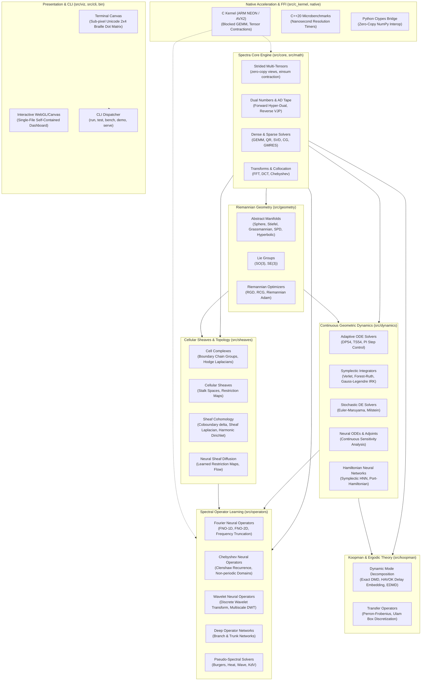

# Spectra System Architecture

Spectra is an end-to-end mathematical computing platform designed for spectral operator learning, cellular sheaf cohomology, and continuous geometric neural dynamics. It is built entirely in Julia with zero external package dependencies, using standard library modules (`LinearAlgebra`, `Statistics`, `Random`, `Printf`, `Dates`, `Test`) alongside native C SIMD acceleration and cross-language interoperability bridges.

---

## 1. Architectural Principles

### 1.1 Zero External Dependencies
Spectra does not rely on third-party Julia package managers or network-fetched dependencies at runtime. All algorithms (including fast Fourier transforms, numerical linear algebra, automatic differentiation, Runge-Kutta integrators, and cellular sheaf representations) are implemented from first principles.

### 1.2 Unified Mathematical Abstraction Hierarchy
The software hierarchy reflects mathematical category theory and differential geometry:
- Top-level manifold structures inherit from `AbstractManifold`.
- Cellular spaces build from simplices and regular cell complexes $(X, \Delta)$.
- Sheaves map cells to vector spaces $(\mathcal{F}(v), \mathcal{F}(e))$ and morphisms $\mathcal{F}_{v \trianglelefteq e}$.
- Dynamical systems exist either as unconstrained continuous flows or constrained symplectic Hamiltonian vector fields.

### 1.3 High-Performance Strided Tensor Engine
Data arrays use strided, column-major contiguous memory layouts. Zero-copy subviews and tensor contractions avoid heap thrashing and guarantee deterministic memory footprint throughout long simulation horizons.

---

## 2. Submodule Breakdown

### Module 1: Core Mathematics (`src/math/`)
Provides the numerical backbone:
- **Automatic Differentiation**: Forward-mode dual and hyper-dual numbers ($f(x + \varepsilon_1 v_1 + \varepsilon_2 v_2)$) for machine-precision gradients and Hessians without roundoff error; dynamic tape-based reverse-mode automatic differentiation with vector-Jacobian products (VJPs).
- **Linear Algebra**: Cache-blocked GEMM, Householder QR factorizations, truncated SVD via Golub-Kahan bidiagonalization, and preconditioned Conjugate Gradient / GMRES Krylov subspace solvers.
- **Sparse Matrices**: Compressed Sparse Column (CSC) and Coordinate (COO) sparse matrix representations with SIMD-vectorized sparse matrix-vector multiplication (SpMV).
- **Spectral Transforms**: Radix-2 Cooley-Tukey FFT, Bluestein chirp-z transform for arbitrary prime lengths, Discrete Cosine Transform (DCT-II), and Chebyshev Gauss-Lobatto collocation matrices.
- **Numerical Optimization**: First-order line-search optimizers (gradient descent, momentum, Adam) and quasi-Newton algorithms (BFGS and L-BFGS two-loop recursion).

### Module 2: Differential & Riemannian Geometry (`src/geometry/`)
Operates on curved non-Euclidean manifolds:
- **Supported Manifolds**: Hypersphere $S^n$, Poincaré ball model $\mathbb{D}^n$, Lorentz hyperboloid $\mathbb{H}^n$, Stiefel manifold $V_k(\mathbb{R}^n)$, Grassmannian $Gr(k, n)$, Symmetric Positive Definite matrices $\mathrm{SPD}(n)$ under the affine-invariant metric, and matrix Lie groups $\mathrm{SO}(3)$ and $\mathrm{SE}(3)$.
- **Operators**: Riemannian metric tensors $g_p(u, v)$, exponential maps $\exp_p(\xi)$, logarithmic maps $\log_p(q)$, metric retractions $R_p(\xi)$, and parallel/vector transport $\mathcal{T}_{p \to q}(\xi)$.
- **Manifold Optimization**: Riemannian Gradient Descent (RGD), Riemannian Nonlinear Conjugate Gradients (RCG) with Polak-Ribière parameter updates, and Riemannian Adam.

### Module 3: Cellular Sheaf Theory (`src/sheaves/`)
Encodes topological spatial structures and local algebraic consistency:
- **Cell Complexes**: Regular cell complexes with oriented incidence matrices and boundary operators $\partial_k$.
- **Sheaf Data Structures**: Fiber stalks $\mathcal{F}(\sigma) \cong \mathbb{R}^d$ assigned to vertices, edges, and faces, with linear restriction maps $\mathcal{F}_{v \trianglelefteq e} \in \mathbb{R}^{d_e \times d_v}$.
- **Cohomological Operators**: Sheaf coboundary map $\delta^0: C^0(X; \mathcal{F}) \to C^1(X; \mathcal{F})$ and cellular Sheaf Laplacian:
  $$L_\mathcal{F} = (\delta^0)^* \delta^0$$
- **Solvers & Diffusion**: Sheaf cohomology $H^0(X; \mathcal{F}) = \ker(L_\mathcal{F})$ computation, harmonic Dirichlet boundary value problem solvers, and Neural Sheaf Diffusion layers with learnable restriction maps.
- **Persistent Homology**: Vietoris-Rips filtration and $\mathbb{Z}_2$ boundary matrix reduction for persistence diagrams.

### Module 4: Continuous Geometric Dynamics (`src/dynamics/`)
Models continuous differential equations:
- **Runge-Kutta Solvers**: Adaptive Dormand-Prince 5(4) and Tsitouras 5(4) with Proportional-Integral (PI) step size controllers.
- **Symplectic Geometric Integrators**: Störmer-Verlet, Forest-Ruth 4th-order symplectic composition, and Implicit Runge-Kutta (Gauss-Legendre 4th/6th order) preserving the symplectic 2-form $\omega = dq \wedge dp$ and quadratic invariants.
- **Stochastic Differential Equations**: Euler-Maruyama and Milstein solvers with Brownian path generators.
- **Adjoint Sensitivity**: Continuous adjoint state method for Neural ODE backpropagation via reverse-time differential integration.
- **Symplectic Neural Networks**: Hamiltonian Neural Networks (HNN) guaranteeing conservation of energy, and Port-Hamiltonian neural networks incorporating dissipation and external input ports.

### Module 5: Spectral Operator Learning (`src/operators/`)
Learns mappings between infinite-dimensional function spaces:
- **Fourier Neural Operators (FNO)**: 1D and 2D FNO architectures parameterizing integral kernel operators in Fourier space with parameterized mode truncation.
- **Chebyshev Neural Operators (CNO)**: Spectral operator layers using Chebyshev polynomial bases and Clenshaw recurrence for non-periodic Dirichlet domains.
- **Wavelet Neural Operators (WNO)**: Multiscale operator learning via Discrete Wavelet Transforms (Haar and Daubechies wavelets).
- **DeepONet**: Universal operator approximation using trunk networks (spatial coordinates) and branch networks (discretized input functions).
- **Ground Truth PDE Solvers**: High-precision pseudo-spectral solvers for viscous Burgers, nonlinear heat, 2D wave, and Korteweg-de Vries (KdV) equations.

### Module 6: Koopman & Transfer Operator Theory (`src/koopman/`)
Analyzes nonlinear dynamical systems through infinite-dimensional linear operators:
- **Dynamic Mode Decomposition**: Exact DMD with optimal singular value truncation, Hankel Alternative View of Koopman (HAVOK) delay embedding, and Extended Dynamic Mode Decomposition (EDMD) with polynomial/RBF dictionaries.
- **Perron-Frobenius Transfer Operators**: Dual transfer operator approximation via Ulam box discretization for computing invariant ergodic measures and Kolmogorov-Sinai entropy.

### Module 7: Native C SIMD Acceleration & Cross-Language Bridges (`native/`, `python/`, `cpp/`)
- **Native C Kernel**: Cache-blocked matrix multiplication, SIMD vectorization (ARM NEON `vld1q_f64`/`vfmaq_f64` and AVX2 `_mm256_fmadd_pd`), and Clenshaw recurrence evaluation.
- **Python Bridge**: Zero-copy ctypes interface providing NumPy interoperability.
- **C++20 Benchmark Harness**: Nanosecond-precision verification and throughput quantification.

### Module 8: Interactive Visualization & Command Line (`src/viz/`, `src/cli/`)
- **Braille Terminal Visualizer**: Sub-pixel $2 \times 4$ dot-matrix rendering using Unicode Braille Patterns (`U+2800` through `U+28FF`), enabling clean plotting of phase spaces and waveforms directly in stdout.
- **Truecolor Heatmaps**: 24-bit ANSI escape terminal rendering for 2D fields.
- **Interactive WebGL Dashboard**: Generates standalone single-file HTML5/WebGL visualizations of trajectories, spectra, and wavefields without web server dependencies.
- **Command Line Dispatcher**: Unified `./bin/spectra` entrypoint for running tests, benchmarks, interactive dashboards, and demonstration scenarios.
